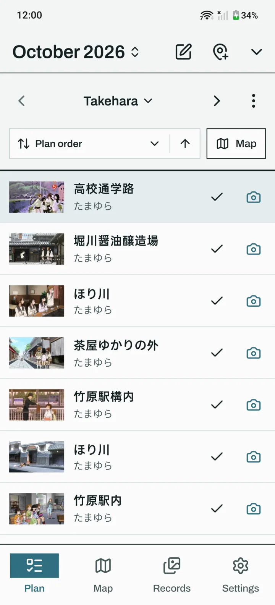
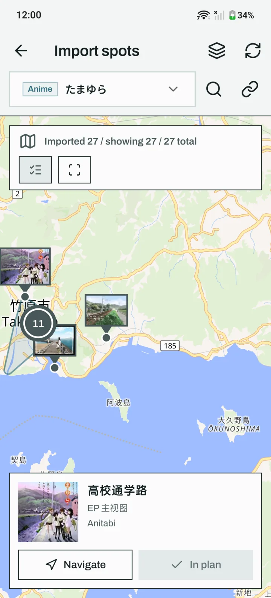
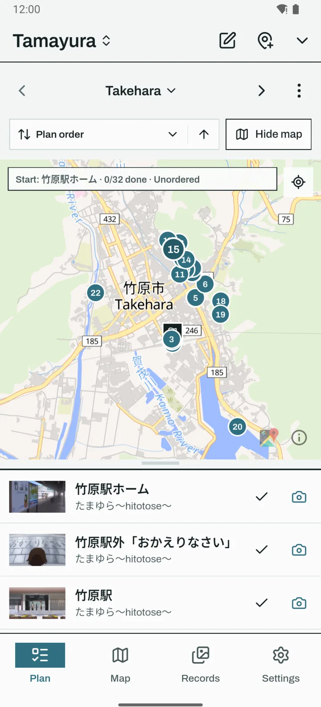
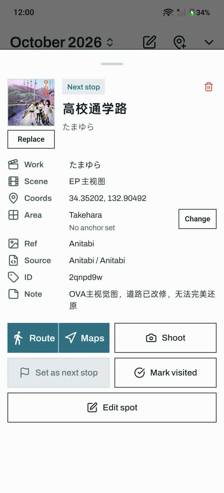

<p align="center">
  
</p>

<h1 align="center">Koma</h1>

<p align="center">
  Plan an anime pilgrimage, walk to each spot, and shoot the photo that matches the frame.
</p>

<p align="center">
  <a href="LICENSE"></a>
  
  
</p>

Koma (コマ, one frame of film or anime) is a fork of [MiriaGo](https://github.com/BilyHurington/MiriaGo) by BilyHurington. It turns an anime's known locations (seichi) into a walkable plan and helps recreate each frame as a photo:

- **Find spots:** search an anime by its English, Japanese or Chinese title, or paste an Anitabi link, then pick spots on the map. Each spot comes with its actual anime frame.
- **Plan:** group spots into areas by city, sort each area into a walking order from where you'll start, and save the plan for offline use (frames and the map) before a trip.
- **Shoot:** the camera overlays the frame on the live view (with adjustable opacity) or stacks the two, so you can match the composition.
- **Afterwards:** line each photo up with its frame, crop to it, colour-match it, and export a side-by-side comparison image.

The UI is in English and Chinese and follows the phone's language.

Website: **[kuro-cat.github.io/koma](https://kuro-cat.github.io/koma/)**

<p align="center">
  
  
  
  
</p>

## Changes from MiriaGo

I maintain Koma for my own Android phone. Upstream MiriaGo also targets iOS and desktop; that code is still here, but I don't test it. Notable changes:

**Language**
- English UI alongside the original Chinese, chosen from the phone's language.
- Anime titles show the Japanese name with a Latin-script alias (from Bangumi) as a subtitle in English.

**Finding and organising spots**
- One screen to find spots: search Bangumi or paste an Anitabi link from inside the import map, with no setup screens in between.
- Searching by an English or romaji title works ("Tamayura", "Your Name"). Bangumi only lists Japanese and Chinese titles, so when it finds nothing Koma looks up the Japanese title on AniList and searches again. If there is still nothing, the screen says so.
- **Group by city:** after an import, one tap puts the spots into one area per city, named after the city. Spots in a city that already has an area join it.
- **Walking order:** choose where an area's walk starts (a spot, any point on the map, or your location) and Koma orders the spots from there, each one the closest to the last. The start is saved with the area, and the area map numbers each spot in that order with a flag at the start, so you can see the rough route without the route planner.
- **Notes on spots and areas:** a spot's note (opening hours, where to stand) sits near the top of its sheet and can be added there; an area's note shows above its list. Notes that come with Anitabi spots show the same way.
- Box-select on the import map puts the boxed spots straight into an area. You can pick an existing area or create one right there, and it works for spots already in the plan too, so you can regroup them later.
- The separate "Manage plan" screen is gone. Its work moved onto the Plan tab:
  - **Edit** (or a long press) selects spots to move, mark visited or delete;
  - spots in manual-order areas can be dragged into order;
  - the area bar has a menu to add a note, rename, sort into walking order, change the order mode, delete, group or box-select ungrouped spots, or open Manage areas.
- The plan name in the header is a picker for switching plans.
- You can start with no plans at all; the empty screen walks you through creating the first one.
- All plans: tapping a plan shows its spots, areas, dates and details, with Edit details and Open plan.
- Upstream's area anchors and "Assign to nearest" are gone; grouping by city and the walk start replace them.
- The inline map stays open when you switch areas and frames the new area's spots.

**Photos**
- **Align & crop:** line a saved photo up with the anime frame and crop it to match. Open a record in Records, then choose Align & crop. Originals are kept.

**Design**
- A ground-up restyle with a calm, uncluttered look:
  - flat surfaces with square corners and no drop shadows;
  - content set out as ruled lists instead of stacks of cards;
  - one set of lines used the same way on every screen, so nothing looks out of place.
- The Archivo typeface throughout, with condensed capitals to name sections and tabular figures so counts line up.
- Quiet, quick motion: details ease open in place and pressed keys invert. The app also follows the phone's setting for reducing animations.
- Five theme colours (Fjord by default, Spruce, Moss, Lake and Ink), plus a custom colour held to the same muted blues, greens and earth tones. The current tab in the nav bar takes on the chosen colour.
- Light and dark themes, both tuned so text stays readable in sunlight and at night.

**Offline**
- **Save for offline** stores a plan's full anime frames and the map around its spots, so the map, the spots and the camera overlay all work with no signal.
- Saving runs in the background with a progress notification, keeps going with the screen locked, and can be cancelled from the notification.

**Navigation**
- Walking routes through a whole area follow the streets. Upstream's default routing server takes at most 10 stops per request, so bigger areas failed and showed straight lines; Koma requests long routes in parts and joins them.
- Without signal, the route screen says that routes need a connection instead of showing a raw network error.
- Back on the Map, Records or Settings tab returns to Plan instead of closing the app, and Back closes an open dropdown first.

Koma installs as its own app (`io.github.kurocat.koma`), next to MiriaGo if you have it. To bring your plans over, export them from MiriaGo as `.sjhplan` packages and import them in Koma.

## Install

Download the latest `Koma-<version>.apk` from [Releases](https://github.com/kuro-cat/koma/releases) and open it on your phone. Android will ask you to allow installs from your browser or file manager the first time. Koma needs Android 7.0 or later.

Updates install over the previous version and keep your data. Every release is signed with the same key, so an APK from anywhere else won't install over it.

## Develop

Requirements:

- Flutter SDK (3.44 or later)
- Android SDK and a JDK
- Optional: a connected Android device

```bash
flutter pub get
flutter analyze
flutter test
```

Build and install a debug APK:

```bash
flutter build apk --debug
adb install -r build/app/outputs/flutter-apk/app-debug.apk
```

For smooth map panning, build `--profile` instead; debug builds are noticeably slower.

A release build needs `android/key.properties` and your own keystore, and fails clearly without them rather than signing with the debug key. Keep both out of git (they are already ignored). Don't uninstall a signed install to fix a signature mismatch: that deletes the app's data.

The iOS, macOS, Windows and Linux builds from upstream (Xcode, and Tauri via `npm run desktop:build`) are unchanged and untested here. See the [upstream README](https://github.com/BilyHurington/MiriaGo#readme) for those.

## Data and third-party services

The code is MIT licensed, but the data the app shows belongs to others:

- **Spots and frames** come from [Anitabi](https://anitabi.cn). Spots, screenshots, images and their metadata belong to the original platforms, contributors or rights holders. The app only fetches them and caches them on your device; the repository does not distribute them.
- **Work search** uses the [Bangumi](https://bgm.tv) API, and [AniList](https://anilist.co) to find the Japanese title when a search in Latin letters finds nothing.
- **Maps** default to OpenFreeMap with MapLibre. OpenStreetMap or a custom XYZ or MapLibre style URL can be set in Settings. Saving a plan for offline use downloads the map around its spots from the same service. Keep the attribution each map service requires.
- **Walking routes** and in-app navigation use Valhalla. A spot can also be opened in an external maps app.

Plans move between devices as `.sjhplan` data packages.

## Credits

- [MiriaGo](https://github.com/BilyHurington/MiriaGo) by BilyHurington and contributors: the app Koma is built on. Its Chinese usage guide is in [docs/USAGE.md](docs/USAGE.md).
- [Lucide](https://lucide.dev) icons via [`lucide_icons_flutter`](https://pub.dev/packages/lucide_icons_flutter) (MIT, Copyright (c) 2024 vqhapp).
- [Archivo](https://fonts.google.com/specimen/Archivo) by Omnibus-Type (SIL Open Font License 1.1).

## License

[MIT](LICENSE). The original copyright notice is kept.
